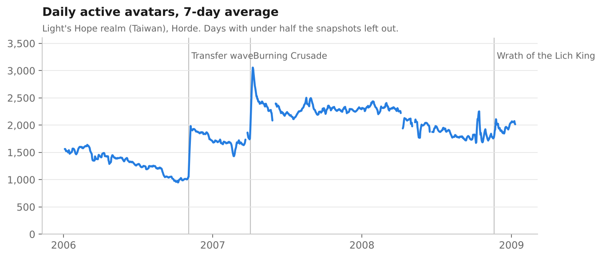
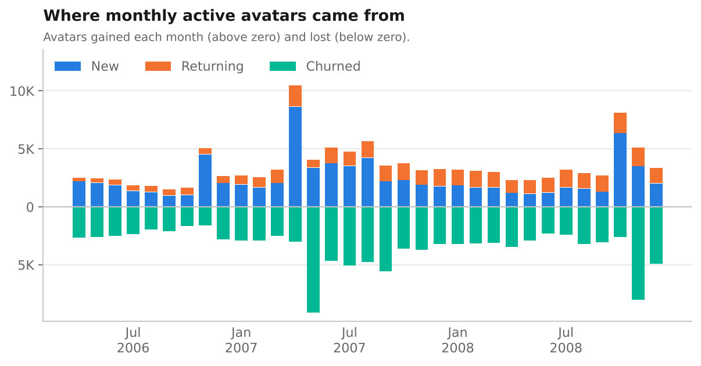
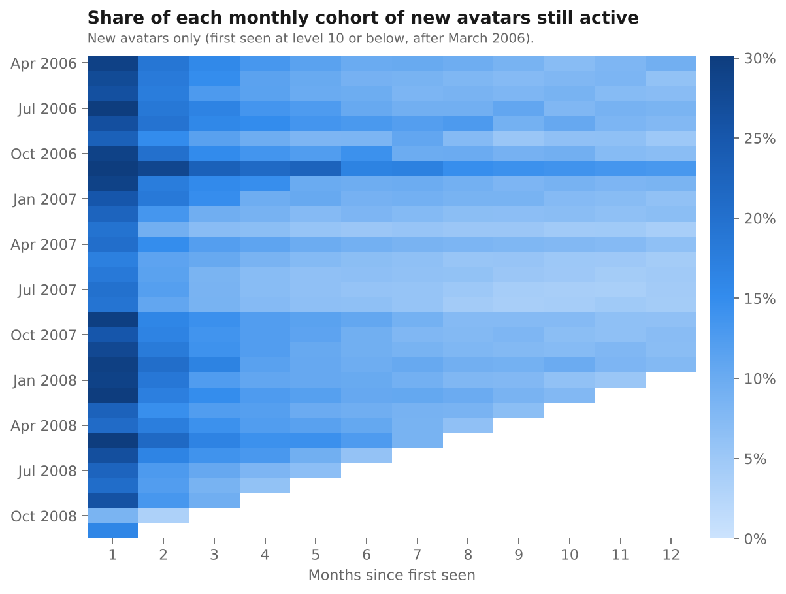
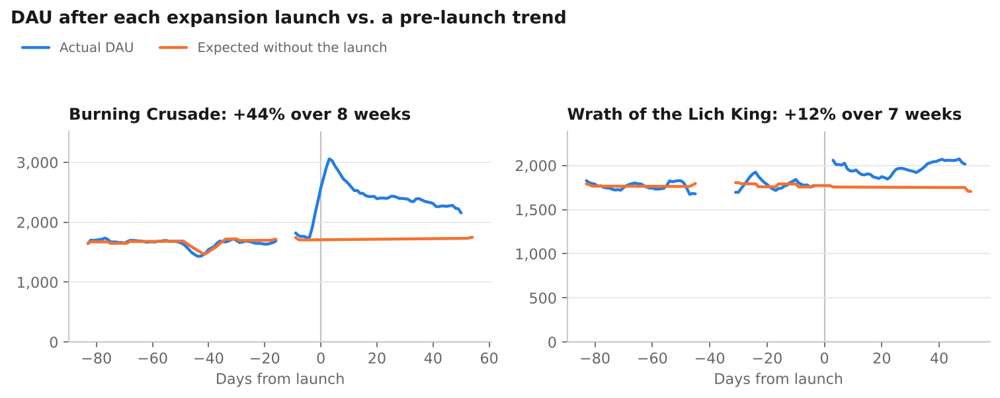
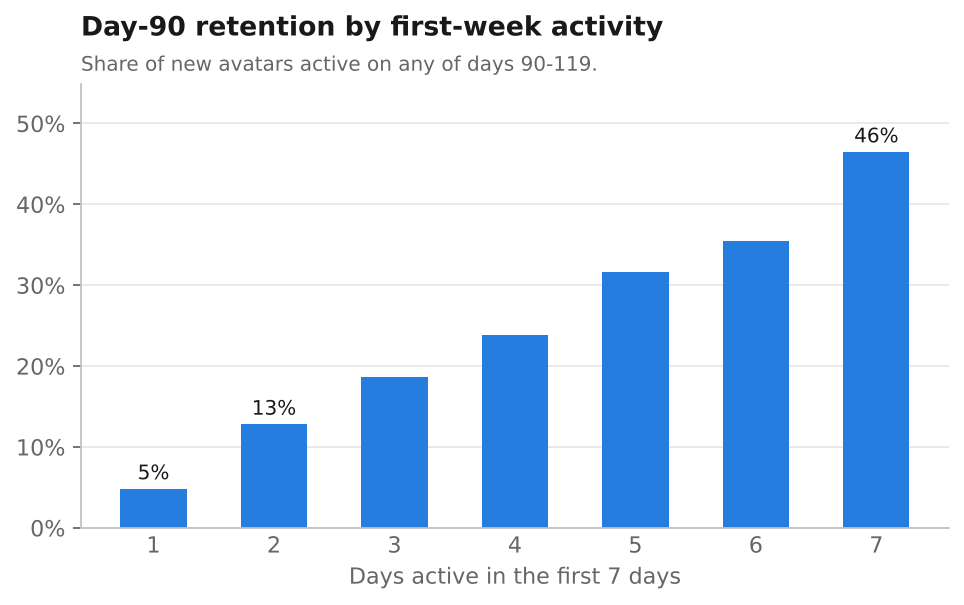
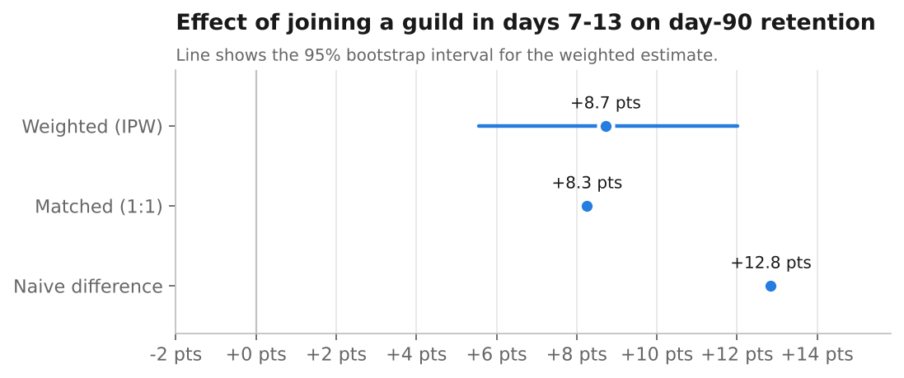
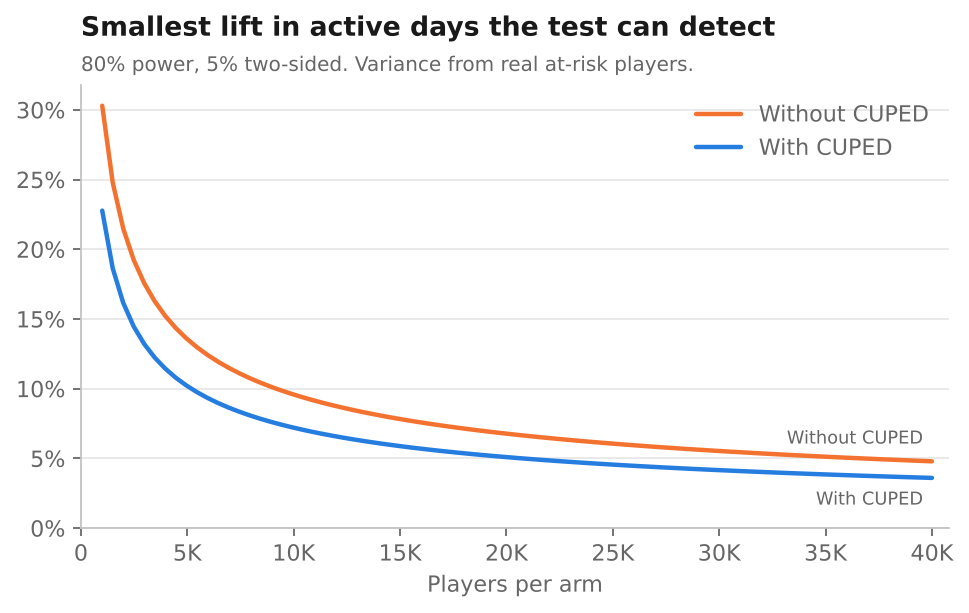

# WoW Player Growth Analytics

[](https://github.com/kennethpangestu/wow-player-growth-analytics/actions/workflows/ci.yml)

Three years of real World of Warcraft player telemetry (36.5M sightings of 91,064 avatars, 2006 to 2009), analyzed the way a game growth team would. It covers where daily players come from, what an expansion launch actually buys, which first-week behaviors keep new players around, whether joining a guild causes better retention, and how to A/B test a fix.

A two-person project. **Kenneth Pangestu** owns analytics and experimentation (this README's results). **Teammate** owns the data platform and ML: the dbt warehouse, churn model, DAU forecast and Streamlit explorer, which are in progress.

> Every result in this README is filled in from [`reports/headline_metrics.json`](reports/headline_metrics.json), which the code writes. A test fails if the two ever disagree. The one-page summary is [`reports/memo.md`](reports/memo.md).

## Results at a glance

| Question | Answer |
|---|---|
| Where do monthly players come from? | Over 33 months, new avatars brought in 69% of gross monthly additions and returning players 31%. Swings in MAU came from new-avatar waves and churn (52% and 42% of the variance), not from returning players (6%). |
| What did The Burning Crusade buy? | **+44% DAU over 8 weeks** (95% CI 38% to 52%), from +79% in week 1 down to +24% in week 8. Players it brought back were no stickier than ordinary returners (33% still active a month later vs. 34%) and half as sticky as players who were already active (68%). |
| And Wrath of the Lich King? | A smaller **+12%** over 53 days (95% CI 6% to 19%). |
| Which first-week behavior predicts day-90 retention? | Playing on **2 or more of the first 7 days**: 22% of those avatars are still around at day 90, vs. 4.8% of the rest (4.7x). Only 39% of new avatars get there. |
| Does joining a guild cause higher retention? | Probably yes: joining in days 7 to 13 raises day-90 retention by **8.7 points** (36.4% to 45.1%, 95% CI 5.6 to 12.0), after balancing on first-week behavior. The naive gap is 12.8 points. |
| Can we A/B test a guild recommendation on this realm? | Only for big effects. CUPED cuts the sample needed by **43%**, but detecting a 5% lift still takes 20,745 players per arm, about 23 four-week windows of this realm's at-risk players. A 20% lift needs 1,297 per arm. |
| What is +1 point of D30 retention worth? | About **+14.7 DAU after 6 months** (0.8% of today's 1,939), from 58 new avatars a day. |



## The data

[World of Warcraft Avatar History (WoWAH)](http://web.cs.wpi.edu/~claypool/mmsys-dataset/2011/wow/), Lee, Chen, Cheng and Lei, MMSys 2011. A collector logged in to one Taiwanese realm (Light's Hope, Horde) and ran `/who` every 10 minutes from January 2006 to January 2009, recording every avatar online with its level, race, class, zone and guild. Avatar and guild names are replaced by consistent random integers.

Before any analysis, the data layer turns 36,513,647 raw rows into 137,654 collection sweeps, 3,162,915 sessions and 1,979,295 player-days. Checking it turned up six things that change results if they're ignored:

1. **The collector slowed down on November 7, 2008**, from a sweep every 10 minutes to about every 15. Sparser sampling misses short logins, so I measured it: keeping 2 of every 3 sweeps on 60 full days before the switch catches 93.7% of daily actives. DAU after the switch is scaled up by that factor, which matters because it covers the whole Wrath of the Lich King launch.
2. **Launch dates come from the data, not from US release dates.** The first avatar above level 60, the first Blood Elf and the first Paladin all appear on April 3, 2007 (The Burning Crusade), and the first avatar above level 70 and the first Death Knight on November 19, 2008 (Wrath of the Lich King). Both are later than the North American launches.
3. **1,134 IDs belong to more than one character.** IDs are anonymized names, and names get reused after a character is deleted: 1,041 IDs drop more than 5 levels between sightings (levels never go down) and 465 show two different race/class combinations. They still count toward DAU and MAU, but they are left out of every analysis that follows individual avatars.
4. **Two waves of avatars that aren't ordinary sign-ups.** On November 3, 2006, 718 avatars appeared in a day, 85% already above level 10 (character transfers). On October 8, 2008, 1,480 appeared, and 89% never got past level 1 (throwaway or spam accounts). Both are in [`docs/event_calendar.csv`](docs/event_calendar.csv) and stay out of the launch baselines.
5. **Maintenance gaps don't end sessions.** Thursday maintenance takes out 8 hours of sweeps every week, and 24 days have no data at all. Sessions are built on collected sweeps only, so a gap in collection is never counted as a player logging off. Days with under half their normal coverage (57 of them) are left out of daily models.
6. **The paper's session count doesn't reconcile.** The authors report 667,032 sessions, but the data has 1,979,295 player-days, so the average session would have to cover about three calendar days. No gap rule gets close: counts run from 3,505,295 (no missed sweeps allowed) to 2,745,743 (six allowed). I use 3,162,915, allowing one missed sweep inside a session. The avatar count matches the paper to within 1 (91,064 vs. 91,065).

Rules and thresholds are defined in [`docs/metrics.md`](docs/metrics.md) and every judgment call is logged in [`docs/decisions.md`](docs/decisions.md).

## Q1. Growth accounting: where do active players come from?



Each month every active avatar is **new** (first month ever), **retained** (also active last month) or **returning** (active before, but not last month). Avatars active last month but not this one have **churned**. From 2006-04 to 2008-12 (the first three months are burn-in, since everyone active at the start looks new):

- An average month gained 2,408 new and 1,105 returning avatars and lost 3,442. The quick ratio ((new + returning) / churned) was above 1 in only 11 of 33 months, with a median of 0.94. Outside launch months the realm was slowly shrinking.
- Month-to-month MAU changes are explained by new-avatar inflow (52% of the variance) and churn (42%). Returning players are a steady 1,105 a month and explain only 6%. Without the two anomaly months the split is 44% new, 49% churn and 7% returning.
- Average DAU was 1,879 and MAU (28-day) 7,569, for a DAU/MAU stickiness of 25%. Peak DAU was 3,273 on April 4, 2007, the day after The Burning Crusade went live.
- Of 60,987 new avatars, 28% came back the next day, 21% in days 7 to 13, 18% in days 30 to 59 and 12% in days 90 to 119.



**So what.** Growth on this realm came in launch-driven bursts of new avatars, and churn was the steady drain. Returning players are a reliable base, not a lever that moves MAU. The biggest opportunity is the first week, where most new avatars are lost (see Q3). *Confidence:* high for the counts. *Caveat:* alts look like new avatars, so "new" overstates new people.

## Q2. Launch impact: what does an expansion buy?



For each launch I fit log DAU on a trend, day-of-week and Lunar New Year over the 12 weeks before, projected it over the weeks after, and compared. The interval comes from a moving-block bootstrap. Three checks back it up: other pre-period windows (8 and 16 weeks with a trend, 4 weeks flat), a year-over-year comparison of the same calendar weeks, and the same estimator at 36 placebo dates with no launch.

| | The Burning Crusade | Wrath of the Lich King |
|---|---|---|
| DAU lift over the post-launch window | **+44%** (95% CI 38% to 52%) | **+12%** (95% CI 6% to 19%) |
| Actual vs. expected average DAU | 2,478 vs. 1,720 | 1,969 vs. 1,760 |
| Other pre-period windows | +37% to +50% | +10% to +13% |
| Year-over-year check | +53% | +10% |
| Share of the 36 placebo dates with a lift this large | 0% | 0% |
| Week 1 → last full week | +79% → +24% | +14% → +17% |

Placebo lifts have a standard deviation of 4.6% and reach at most 10% in absolute value, so both launches are well outside normal noise. For Wrath, leaving the October 2008 level-1 wave inside the baseline would inflate it and cut the estimate to +8% (95% CI -4% to +19%).

**Did the players it brought back stay?** Avatars active in the two weeks after each launch, by what they were doing in the 30 days before, and whether they were active again in days 30 to 43:

| | Burning Crusade: share of entrants | Still active a month later | Same segment 13 weeks earlier |
|---|---|---|---|
| Already active | 33% | 68% | |
| Reactivated (lapsed 30+ days) | 11% | 33% | 34% |
| New avatars | 56% | 17% | 19% |

For Wrath of the Lich King: 30% of reactivated players were still active a month later (35% for ordinary returners), vs. 69% of already-active players.

**So what.** The Burning Crusade was a very large event, about 37,929 extra player-days in 8 weeks. But more than half of the avatars who showed up in launch weeks were new (largely Blood Elf alts) and only 17% of them were around a month later, and reactivated players lapsed again at their usual rate. A launch buys attention, not loyalty. The follow-up that pays is a re-engagement plan for the weeks after launch, aimed at reactivated players and fresh alts. *Confidence:* high for TBC (every check agrees), moderate for Wrath (shorter window, slower sampling, and the anomaly decision moves it). *Caveat:* one realm, and observational: the counterfactual assumes the pre-launch trend would have continued.

## Q3. Early behaviors: what keeps new players around?



**The "aha" threshold.** I scanned thresholds on five first-week behaviors for 60,987 new avatars and scored each by how cleanly it separates avatars still active at day 90 from the rest (Youden's J). The best single signal is playing on **2 or more of the first 7 days**. 39% of new avatars do, and 22% of them are active in days 90 to 119, vs. 4.8% of the rest. Sessions, hours played and levels gained come next ([`reports/tables/q3_aha_best.csv`](reports/tables/q3_aha_best.csv)). This is correlation: it tells us who to watch, not what causes retention.

**Does joining a guild cause higher retention?** Only 8% of new avatars are in a guild by the end of week 1. To get a causal estimate the timeline is kept strict:

- days 0 to 6: baseline behavior (active days, hours, sessions, levels, class, race, start quarter); avatars already in a guild are excluded
- days 7 to 13: treatment, joining a first guild, among avatars active at least once that week
- days 90 to 119: outcome, active at least once

1,007 of 9,866 eligible avatars joined a guild in week 2. A propensity model reweights the 8,859 controls to look like the joiners (largest standardized difference 0.68 before, 0.01 after; effective control sample 5,055).



| Estimate | Day-90 retention: joiners vs. comparable non-joiners | Difference |
|---|---|---|
| Naive | 45.1% vs. 32.2% | +12.8 pts |
| Inverse propensity weighting | 45.1% vs. 36.4% | **+8.7 pts** (95% CI 5.6 to 12.0) |
| 1:1 matching on the propensity score | | +8.3 pts |

The risk ratio is 1.24. Its **E-value is 1.79** (1.57 for the lower confidence bound): an unmeasured confounder would need to raise both the chance of joining and the chance of being retained by about 1.8x, beyond everything already controlled for, to explain the effect away.

**So what.** About 32% of the raw guild gap is selection (engaged players join guilds), but a real effect of about 8.7 points survives. That makes guild joining in week 2 a credible lever, and it is worth an experiment (Q6). *Confidence:* moderate. *Caveats:* observational, an avatar is not a person, and "joined a guild" may stand in for having friends in the game.

## Q6. Experiment design: testing a guild recommendation

The feature would recommend guilds to at-risk players who aren't in one. Until the churn model's scores land, "at risk" means fewer active days in the last 14 days than in the 14 before. Pooling 23 historical four-week windows gives 41,436 player-windows of real data, about 1,802 eligible players per window.

- **Primary metric:** active days in the 28 days after assignment (mean 1.63, SD 3.93; 67% of players have zero). **Secondary:** active at all in days 14 to 27 (baseline 24%; +2 points needs 7,363 per arm). **Guardrail:** minutes per active day must not fall, since a recommendation spammed at players could annoy them.
- **CUPED** with pre-period active days and hours (correlation 0.66) removes 43% of the variance, cutting the sample needed by 43%.

| Lift to detect (relative) | Per arm, no CUPED | Per arm, CUPED | Four-week windows of this realm |
|---|---|---|---|
| 5% | 36,711 | 20,745 | 23.0 |
| 10% | 9,178 | 5,187 | 5.8 |
| 20% | 2,295 | 1,297 | 1.4 |



**Checked by simulation on the real players:**

- **A/A tests** (random splits, no treatment): false-positive rates of 5.6% without CUPED and 5.2% with it across 4,000 tests, close to the 5% target.
- **Effect injection:** planting a +10% lift (0.17 days) in 5,000 players per arm, CUPED detects it 81% of the time (the design target is 80%) vs. 57% without. Both estimates are unbiased (average 0.17 days).
- **Peeking:** checking an A/A test every day and stopping at the first p < 0.05 gives a false positive 15% of the time, vs. 4.7% at a fixed 28-day horizon. Half of those false alarms come by day 3. Fix the horizon, or use a sequential test.
- **Sample ratio mismatch:** a 52/48 split on 10,000 players gives p < 0.001, so the test is stopped and the assignment debugged before anyone reads the metrics.

**So what.** Run it as a fixed-horizon 28-day test with CUPED. On one realm, target a lift of 20% or more, or run it across realms; with a whole game's player base, a 5% lift is well within reach. The full plan is in [`experiments/README.md`](experiments/README.md).

## Opportunity sizing

Raising D30 retention by 1 point keeps 1% more of each day's 58 new avatars past day 30, and each of them then plays like a typical retained avatar. Summed over 6 months of arrivals, that is **+14.7 DAU at month 6** (0.8% of 1,939, the average DAU of the last 56 days) and 1,318 extra player-days. It ignores any extra play before day 30, so it errs low. When the teammate's DAU forecast lands in `reports/dau_forecast.csv`, the baseline switches to it automatically.

## How to run it

```bash
pip install -r requirements.txt
make data       # download the dataset (318 MB) and check its SHA-256
make analysis   # build tables, run Q1-Q6 and sizing, write reports/ (about 2 minutes)
make docs       # fill README.md, reports/memo.md and experiments/README.md from the metrics JSON
make test       # unit tests (CI also runs the whole pipeline on a synthetic fixture)
make all        # all of the above
```

```
ingest/download.py        download and verify the dataset
growth/data.py            snapshots -> sweeps, sessions, player-days, avatars (+ data quality)
growth/metrics.py         Q1: DAU/WAU/MAU, growth accounting, cohort retention
growth/launch.py          Q2: counterfactual lift, placebos, year-over-year, launch cohorts
growth/early.py           Q3: aha thresholds, propensity weighting and matching, E-values
growth/sizing.py          opportunity sizing
experiments/              Q6: at-risk population, power, CUPED, A/A, effect injection, peeking, SRM
scripts/run_analysis.py   runs everything and writes reports/
scripts/render_docs.py    fills README, memo and experiment plan from headline_metrics.json
scripts/make_fixture.py   synthetic data for CI
reports/                  headline_metrics.json, tables/, tableau/ extracts, figures/, memo.md
dashboards/SPEC.md        the Tableau growth dashboard
docs/                     metric definitions, data contract, decisions, event calendar
```

## Caveats

- One Taiwanese Horde realm, 2006 to 2009. Patterns may not carry over to other realms, regions or today's games.
- An avatar is not a player. Alts look like new players, and players who switch characters look like churn.
- Sessions and minutes are inferred from 10- or 15-minute snapshots, so short logins are missed.
- Left censoring: avatars active in early 2006 are not new, hence the 3-month burn-in. Right censoring: day-90 retention needs 120 days of future data, so cohorts after mid-September 2008 are left out.
- Q2 and Q3 are observational. Their assumptions are stated above, and the sensitivity checks show how far the conclusions can move.

## Citation

Y.-T. Lee, K.-T. Chen, Y.-M. Cheng and C.-L. Lei, "World of Warcraft Avatar History Dataset," *Proceedings of ACM Multimedia Systems (MMSys)*, 2011. The authors make the dataset free to download for research. It is not included in this repo. The parquet conversion used here is by Vincent Warmerdam ([koaning/wow-avatar-datasets](https://github.com/koaning/wow-avatar-datasets)).

World of Warcraft is a trademark of Blizzard Entertainment, now part of Microsoft Gaming. This project is not affiliated with either.

## License

MIT
